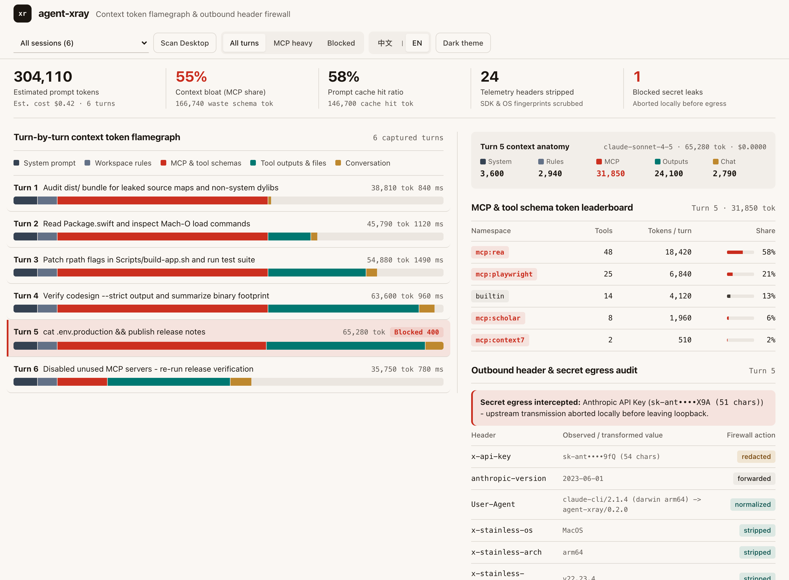

# agent-xray

**English** | **[简体中文](README.zh-CN.md)**

**Zero-MITM-cert local streaming proxy & bilingual (`中文 | EN`) 5-bucket Context Token Flamegraph inspector (`v0.2.0`) for AI coding agents (`Claude Code`, `Codex`, `OpenCode`).**



Ever wondered why a 20-word prompt in `Claude Code`, `Codex`, or `OpenCode` just billed **48,000 input tokens** - or what SDK telemetry headers and pasted `.env` tokens are leaving your machine?

**agent-xray** wraps any coding agent CLI over a `127.0.0.1` loopback HTTP/SSE passthrough (`ANTHROPIC_BASE_URL` / `OPENAI_BASE_URL`) with **zero custom TLS root certificates**, **zero third-party Python dependencies**, and **zero streaming latency**.

## What It Reveals

1. **5-Bucket Turn-by-Turn Context Token Flamegraph** - Decomposes every Anthropic `/v1/messages` and OpenAI `/v1/responses` or `/v1/chat/completions` turn into:
   - **System prompt** (core agent harness)
   - **Workspace rules** (`AGENTS.md`, `CLAUDE.md`, `<user_rules>`, `<system-reminder>`)
   - **MCP & tool schemas** - ranked per MCP server namespace (`mcp:rea`, `mcp:playwright`, `mcp:scholar`, `builtin`) so you immediately spot 30k-token schema bloat
   - **Tool outputs & file reads** (`tool_result` / `function_call_output` growth across turns)
   - **Conversation history**
2. **KPI Telemetry Strip & Session Selector (`v0.2.0`)** - Surfaces estimated prompt tokens, session USD cost, context bloat %, prompt cache hit ratio, waste schema tokens, stripped telemetry headers, and blocked secret leaks, with per-session filtering and one-click local Desktop session scanning (`OpenCode Desktop` & `Claude`).
3. **Outbound Header Audit & Telemetry Stripper (`--strip-telemetry-headers`)** - Audits outbound headers, redacts API keys before storage, strips `x-stainless-*` / telemetry headers, and normalizes `User-Agent` OS/CPU fingerprints.
4. **Local Secret Egress Guard (`--block-secrets`)** - Detects live credentials (`sk-ant-...`, `sk-proj-...`, `ghp_...`, `AKIA...`, PEM private keys) accidentally included in prompts or tool outputs and aborts the request locally with HTTP `400` *before* a single byte hits the upstream network.
5. **Full Bilingual CLI & Live Web UI (`v0.2.0`)** - Supports `--lang {auto,zh,en}`, `AGENT_XRAY_LANG`, and system locale (`zh*`) auto-detection across terminal summaries and the Web Flamegraph Workbench, with a top-bar `中文 | EN` live switcher pill (`localStorage` persisted + `?lang=zh` URL override).

## Quick Start

Requires Python 3.10+ (standard library only):

```bash
git clone https://github.com/zxu756/agent-xray.git
cd agent-xray
uv tool install --editable .
# or: pip install -e .
```

### Wrap Any Coding Agent Session

```bash
# Wrap Claude Code with live Context Flamegraph + telemetry header stripping + secret guard
agent-xray run --strip-telemetry-headers --block-secrets -- claude

# Chinese CLI & Web UI default
agent-xray --lang zh run --strip-telemetry-headers --block-secrets -- claude

# Inspect local OpenCode Desktop & Claude transcripts without proxy setup
agent-xray desktop --open
```

While the agent runs, open the live URL printed in your terminal (e.g. `http://127.0.0.1:8788/_xray/`) to inspect the Context Token Flamegraph in real time. When the session exits, `agent-xray` prints a concise breakdown of your top token-consuming MCP namespaces.

### Standalone Proxy Mode

```bash
agent-xray serve --port 8788 --strip-telemetry-headers --block-secrets
```

Then point any tool at:
- `ANTHROPIC_BASE_URL=http://127.0.0.1:8788/anthropic`
- `OPENAI_BASE_URL=http://127.0.0.1:8788/openai/v1`

### Generate Offline Demo Inspector

```bash
agent-xray export-demo --out docs/demo-inspector.html
```

## Architecture & Security Invariants

- **Loopback-only by default** (`127.0.0.1`), SQLite database created with `0600` permissions (`~/.agent-xray/traces.db`).
- **Zero raw secrets persisted**: `Authorization` / `x-api-key` headers and matched prompt credentials are masked before memory or disk storage.
- Full specification: [docs/SPEC.md](docs/SPEC.md).

## License

MIT
