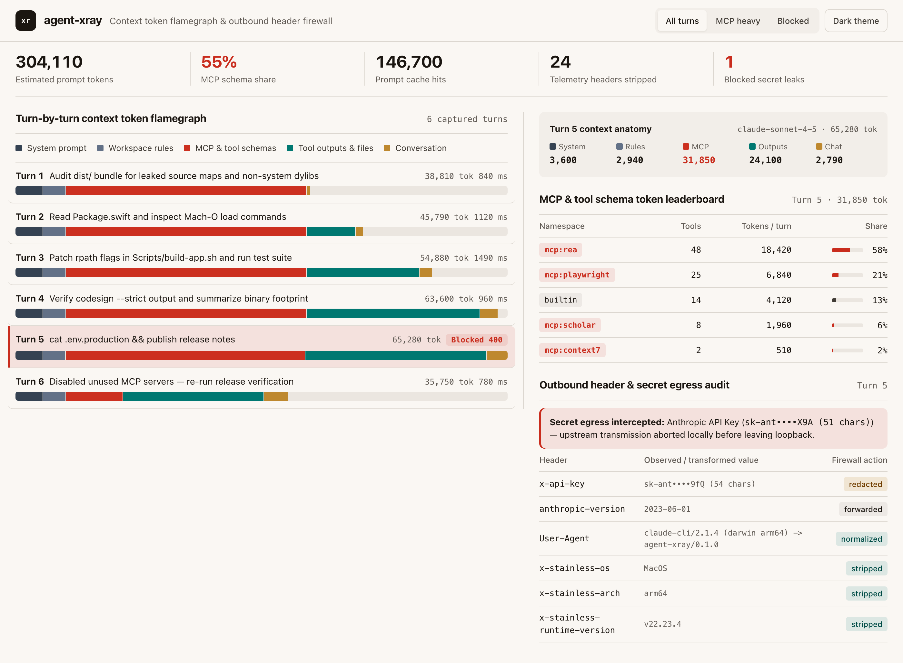

# agent-xray

**English** | **[简体中文](README.zh-CN.md)**

**Zero-MITM-cert local loopback proxy & bilingual (`中文 | EN`) 5-bucket Context Token Flamegraph inspector (`v0.2.0`, M0 Honest Audit) for AI coding agents (`Claude Code`, `Codex`, `OpenCode`).**



> **[DEMO] Screenshot notice:** The screenshot above shows the deterministic synthetic fixture generated by `agent-xray export-demo` (`build_demo_dataset()`), not a live user trace. Metric labels in the M0 release were renamed for algorithmic accuracy (`MCP Tool Share`, `Tool Definition Tokens`, `Stripped Telemetry Headers`, header `Value length`); generate or open [`docs/demo-inspector.html`](docs/demo-inspector.html) to inspect the current UI.

**agent-xray** wraps coding agent CLIs over a `127.0.0.1` loopback HTTP/SSE passthrough (`ANTHROPIC_BASE_URL` / `OPENAI_BASE_URL`) with **zero custom TLS root certificates** and **zero third-party Python runtime dependencies**.

> **Upgrade Security Notice (`<= v0.2.0` users):** Trace databases created by `v0.1.0` or unpatched `v0.2.0` (`~/.agent-xray/traces.db`) stored 140-character prompt previews that were truncated *before* regex redaction (allowing truncated secret prefixes to land on disk) and persisted non-auth HTTP header values. After updating, immediately purge any legacy database:
> ```bash
> agent-xray purge-db
> ```

## What It Reveals

1. **5-Bucket Turn-by-Turn Context Token Flamegraph (Live Proxy Mode)** - Decomposes captured Anthropic `/v1/messages` and OpenAI `/v1/responses` or `/v1/chat/completions` JSON requests into:
   - **System prompt** (core agent harness)
   - **Workspace rules** (`AGENTS.md`, `CLAUDE.md`, `<user_rules>`, `<system-reminder>`)
   - **MCP & tool schemas** (`Tool Definition Tokens`) - ranked per MCP server namespace (`mcp:rea`, `mcp:playwright`, `mcp:scholar`, `builtin`), separating **`MCP Tool Share`** (`mcp:*` schema tokens / total estimated input tokens) from built-in tool schemas
   - **Tool outputs & file reads** (`tool_result` / `function_call_output` growth across turns)
   - **Conversation history**
2. **Dated Per-Model Cost & Prompt Cache Hit Rate (`2026-11` price table)** - Computes prompt cache hit rate as `cache_read / (input + cache_read + cache_write)` and calculates turn cost from per-model input, `cache_read`, `cache_write`, and output rates (`claude-sonnet-*`, `claude-opus-*`, `claude-haiku-*`, `gpt-4o*`, `gpt-4.1*`, `gpt-5*`, `o3*`, `codex-mini*`). Unrecognized models display **`Unknown price`** (`null` in JSON) instead of guessing another model's rate; failed or blocked turns (`HTTP >= 400`) bill `$0.0000`.
3. **Local Session Aggregate Usage Import (`desktop`)** - Imports per-turn token usage (`input`, `cache_read`, `cache_write`, `output`) from local `OpenCode Desktop` (`session_message`) and `Claude Code` (`~/.claude/projects/*/*.jsonl`, deduplicated by `(message.id, requestId)`). Because local logs do not retain raw wire payloads, 5-bucket breakdown is reported honestly as **`No data`** (`has_bucket_breakdown = false`) rather than fabricated with fixed ratios.
4. **Outbound Header Audit & Telemetry Stripper (`--strip-telemetry-headers`)** - Audits outbound headers while persisting **only header name and byte/char length (`value_length`)**, strips `x-stainless-*` / `x-client-data` telemetry headers, and normalizes `User-Agent` (`Stripped Telemetry Headers` counts strictly stripped headers, excluding normalized `User-Agent`).
5. **Pattern-Based Secret Egress Guard (`--block-secrets`)** - Scans JSON payloads on `/v1/messages`, `/v1/chat/completions`, and `/v1/responses` for common credential formats (`sk-ant-...`, `sk-proj-...`, `sk-or-v1-...`, legacy `sk-...`, `ghp_...`, `github_pat_...`, `AKIA...`, `xoxb-...`, `AIza...`, JWTs, and multi-line PEM private keys). When `--block-secrets` is enabled, matching requests are aborted locally with HTTP `400` before upstream forwarding, storing only the matched rule name and JSON field path.
6. **Loopback Rebinding & Mutation Auth Guards** - Validates `Host` and `Origin`/`Referer` against the bound loopback port (`HTTP 403` on DNS-rebinding or cross-origin requests), requires a cryptographic `X-Xray-Token` on state-changing `POST` endpoints, and refuses `--allow-lan` unless `--auth-token <token>` is explicitly supplied.

## What Is Persisted to SQLite (`traces` Table)

By default, trace metadata is written to `~/.agent-xray/traces.db` (`0600` permissions; override with `--db <path>` or `:memory:`):

| Column | Persisted Content | Privacy Rule |
|---|---|---|
| `provider`, `model`, `path`, `status_code`, `latency_ms`, `blocked` | Turn routing, HTTP status, elapsed ms, block flag | Metadata only |
| `buckets_json`, `namespaces_json`, `usage_json` | Integer token counts per bucket/MCP namespace and upstream token usage | Numeric counts only |
| `headers_json` | `[{"name": "...", "value_length": 54, "category": "...", "action": "..."}]` | **Header name and `value_length` only**; raw or partial header values are never stored |
| `secrets_json` | `[{"rule": "Anthropic API Key", "field": "messages[0].content"}]` | **Rule category and JSON field path only**; matched secret text is never stored |
| `prompt_preview` | `""` (empty string) by default | Stored **only** when `--store-previews` is explicitly passed; runs full-text secret redaction *before* truncating to 140 chars, and is always `""` on blocked (`400`) turns |

## Known Current Limitations (M0 Baseline)

- **SSE chunk buffering**: Streaming responses currently read 4096-byte chunks from `http.client` (`read(4096)`), which can introduce sub-chunk buffering on sparse SSE streams compared to `read1()`.
- **JSON endpoint scope**: Payload classification and secret scanning inspect uncompressed JSON bodies on `/v1/messages`, `/v1/chat/completions`, and `/v1/responses` (not gzip-compressed request bodies, query strings, or `/v1/files` multipart uploads).
- **Token bucket estimation**: Input bucket splits use a deterministic character/CJK heuristic reconciled alongside exact upstream `usage` totals.

## Quick Start

Requires Python 3.10+ (standard library only):

```bash
git clone https://github.com/zxu756/agent-xray.git
cd agent-xray
python3 -m venv .venv
.venv/bin/pip install -e .
```

### Verify CLI & Export Static `[DEMO]` Inspector

```bash
agent-xray --version
agent-xray export-demo --out docs/demo-inspector.html
```

### Wrap a Coding Agent Session (Loopback Proxy)

```bash
# Wrap an agent command (no prompt previews stored on disk by default)
agent-xray run --strip-telemetry-headers --block-secrets -- <your-agent-command>

# Chinese CLI & Web UI default, isolated SQLite DB path
agent-xray --lang zh run --db /tmp/xray-session.db --strip-telemetry-headers --block-secrets -- <your-agent-command>
```

### Standalone Proxy Mode

```bash
agent-xray serve --port 8788 --db /tmp/xray-serve.db --strip-telemetry-headers --block-secrets
```

Point your client at:
- `ANTHROPIC_BASE_URL=http://127.0.0.1:8788/anthropic`
- `OPENAI_BASE_URL=http://127.0.0.1:8788/openai/v1`

### Inspect Local Sessions (`desktop`), Summarize (`report`), & Purge (`purge-db`)

```bash
# Import aggregate token usage from local OpenCode Desktop & Claude Code into a temporary DB
agent-xray desktop --db /tmp/xray-desktop.db --import-only

# Print EN or ZH terminal summary from an existing trace DB
agent-xray --lang en report --db /tmp/xray-desktop.db
agent-xray --lang zh report --db /tmp/xray-desktop.db

# Delete a trace database and its -wal / -shm sidecars
agent-xray purge-db --db /tmp/xray-desktop.db
```

## Architecture & Specification

Full engineering specification: [docs/SPEC.md](docs/SPEC.md).

## License

MIT
