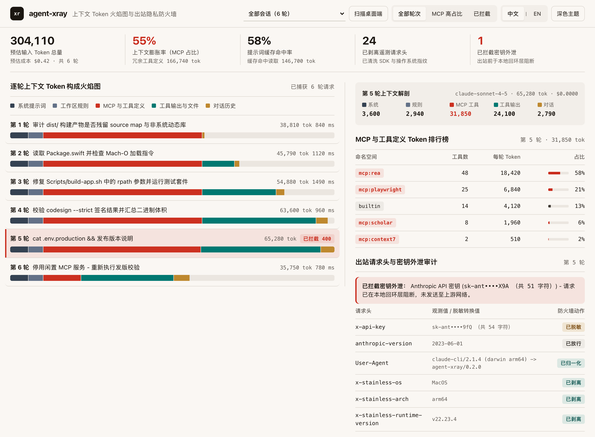

# agent-xray

**[English](README.md)** | **简体中文**

**免安装 MITM 根证书的本地回环代理与中英双语（`中文 | EN`）五维上下文 Token 火焰图检查器（`v0.2.0`，M0 诚实化修订版），面向 AI 编程智能体（`Claude Code`、`Codex`、`OpenCode`）。**



> **[DEMO / 演示数据] 截图说明：** 上方截图展示的是由 `agent-xray export-demo`（`build_demo_dataset()`）生成的确定性静态演示数据集，并非真实用户会话记录。M0 版本已将指标名称与底层公式对齐（`MCP 工具定义占比`、`工具定义占用`、`去掉的遥测头`、请求头 `值长度`）；可直接打开或重新导出 [`docs/demo-inspector.html`](docs/demo-inspector.html) 查看最新界面。

**agent-xray** 通过 `127.0.0.1` 本地回环 HTTP/SSE 代理（注入 `ANTHROPIC_BASE_URL` / `OPENAI_BASE_URL`）包装编程智能体 CLI，**无需安装自定义 TLS 根证书**，且 **零第三方 Python 运行时依赖**。

> **升级安全提示（`<= v0.2.0` 老版本用户必读）：** `v0.1.0` 与未打补丁的 `v0.2.0` 生成的追踪数据库（默认 `~/.agent-xray/traces.db`）曾默认保存 140 字符的提示词预览，且采用“先截断后正则脱敏”逻辑（截断后的残缺密钥前缀可能写入磁盘），同时保存了非认证类 HTTP 请求头的原始值。升级后请立即执行以下命令彻底清理旧数据库：
> ```bash
> agent-xray --lang zh purge-db
> ```

## 核心功能与指标定义

1. **五维逐轮上下文 Token 构成火焰图（实时代理模式）** - 将捕获到的 Anthropic `/v1/messages` 与 OpenAI `/v1/responses`、`/v1/chat/completions` JSON 请求拆解为 5 个维度：
   - **系统提示词（System prompt）**：智能体核心底座提示词
   - **工作区规则（Workspace rules）**：`AGENTS.md`、`CLAUDE.md`、`<user_rules>`、`<system-reminder>`
   - **MCP 与工具定义（`工具定义占用`）**：按服务命名空间（`mcp:rea`、`mcp:playwright`、`mcp:scholar`、`builtin`）分组排序，严格区分 **`MCP 工具定义占比`**（`mcp:*` 定义 Token / 总估算输入 Token）与内置工具定义
   - **工具输出与文件读取（Tool outputs & files）**：`tool_result` / `function_call_output` 返回内容
   - **对话历史（Conversation history）**
2. **标注日期的分模型计价表与提示词缓存命中率（`2026-11` 价格表）** - 缓存命中率统一按 `cache_read / (input + cache_read + cache_write)` 计算；单轮与汇总费用按对应模型的输入、`cache_read`、`cache_write`（缓存写入）与输出单价计算（覆盖 `claude-sonnet-*`、`claude-opus-*`、`claude-haiku-*`、`gpt-4o*`、`gpt-4.1*`、`gpt-5*`、`o3*`、`codex-mini*`）。未收录价格的模型明确显示 **`未知价格`**（JSON 中为 `null`），绝不套用其他模型单价；失败或本地拦截轮次（`HTTP >= 400`）计费为 `$0.0000`。
3. **本地会话聚合用量导入（`desktop`）** - 只读读取本机 `OpenCode Desktop`（`session_message` 逐轮表）与 `Claude Code`（`~/.claude/projects/*/*.jsonl`，按 `(message.id, requestId)` 去重流式分块）中的真实单轮 Token 用量（`input`、`cache_read`、`cache_write`、`output`）。由于本地日志不含原始 HTTP 请求体，五桶拆解明确标记为 **`没有数据`**（`has_bucket_breakdown = false`），不使用固定比例伪造五桶分布。
4. **出站请求头审计与遥测头剥离（`--strip-telemetry-headers`）** - 审计出站 HTTP 请求头，数据库中**仅持久化请求头名称与字符长度（`value_length`）**，剥离 `x-stainless-*`、`x-client-data` 等遥测头并归一化 `User-Agent`（`去掉的遥测头` 仅统计真正移除的请求头，不把归一化的 `User-Agent` 算入剥离数）。
5. **基于规则模式的密钥外泄拦截（`--block-secrets`）** - 在 `/v1/messages`、`/v1/chat/completions` 与 `/v1/responses` 的 JSON 请求体中扫描常见凭据格式（`sk-ant-...`、`sk-proj-...`、`sk-or-v1-...`、传统 `sk-...`、`ghp_...`、`github_pat_...`、`AKIA...`、`xoxb-...`、`AIza...`、JWT 与多行 PEM 私钥块）。开启 `--block-secrets` 后，命中请求在本地直接返回 HTTP `400` 阻断，且数据库仅记录命中的规则类别与 JSON 字段路径。
6. **本地回环重绑定防护与写操作令牌鉴权** - 校验所有检查器页面与 API 请求的 `Host` 及 `Origin`/`Referer`（拒绝 DNS 重绑定与跨源请求，返回 `HTTP 403`）；对扫描本地会话、清空记录等状态变更 `POST` 接口强制校验启动随机生成的 `X-Xray-Token`；启用 `--allow-lan` 时必须显式传入 `--auth-token <token>`，否则拒绝启动。

## SQLite 落盘字段说明（`traces` 表）

默认数据库路径为 `~/.agent-xray/traces.db`（权限 `0600`，可通过 `--db <路径>` 或 `:memory:` 覆盖）：

| 字段名 | 落盘内容 | 隐私与数据规则 |
|---|---|---|
| `provider`, `model`, `path`, `status_code`, `latency_ms`, `blocked` | 供应商、模型名、路径、HTTP 状态码、耗时毫秒、拦截标记 | 仅元数据 |
| `buckets_json`, `namespaces_json`, `usage_json` | 五桶估算整数 Token、MCP 命名空间统计与上游返回的真实 Token 计数 | 仅数值统计 |
| `headers_json` | `[{"name": "...", "value_length": 54, "category": "...", "action": "..."}]` | **仅保存请求头名称与长度 `value_length`**，绝不保存任何原始或截断请求头值 |
| `secrets_json` | `[{"rule": "Anthropic API Key", "field": "messages[0].content"}]` | **仅保存命中的规则名与 JSON 字段路径**，绝不保存密钥原文或片段 |
| `prompt_preview` | 默认为空字符串 `""` | **默认不落盘任何提示词文本**；仅在显式开启 `--store-previews` 时先对全文做密钥脱敏、再截断至 140 字符，且被拦截（`400`）轮次始终为空字符串 `""` |

## 当前已知边界（M0 基线）

- **SSE 分块读取缓冲**：当前流式转发使用 `http.client` 的 `read(4096)`，在稀疏小帧 SSE 流下相比 `read1()` 仍可能产生单块内的缓冲延迟。
- **JSON 端点范围**：请求分类与密钥扫描当前覆盖未压缩 JSON 请求体的 `/v1/messages`、`/v1/chat/completions` 与 `/v1/responses`（暂不解压 `gzip` 请求体，也不扫描 URL 查询串或 `/v1/files` 文件上传）。
- **输入分桶估算**：五桶输入拆解基于确定性字符/中日韩（CJK）启发式估算，并与上游响应返回的真实 `usage` 汇总对照展示。

## 快速上手

环境要求：Python 3.10+（仅依赖 Python 标准库）：

```bash
git clone https://github.com/zxu756/agent-xray.git
cd agent-xray
python3 -m venv .venv
.venv/bin/pip install -e .
```

### 查看版本并导出离线 `[DEMO]` 演示工作台

```bash
agent-xray --version
agent-xray --lang zh export-demo --out docs/demo-inspector.html
```

### 包装编程智能体会话（本地回环代理）

```bash
# 包装智能体命令（默认不在磁盘保存任何提示词预览）
agent-xray --lang zh run --strip-telemetry-headers --block-secrets -- <你的智能体命令>

# 指定独立 SQLite 数据库路径运行
agent-xray --lang zh run --db /tmp/xray-session.db --strip-telemetry-headers --block-secrets -- <你的智能体命令>
```

### 独立代理服务模式

```bash
agent-xray --lang zh serve --port 8788 --db /tmp/xray-serve.db --strip-telemetry-headers --block-secrets
```

将客户端指向：
- `ANTHROPIC_BASE_URL=http://127.0.0.1:8788/anthropic`
- `OPENAI_BASE_URL=http://127.0.0.1:8788/openai/v1`

### 导入本机桌面会话（`desktop`）、终端汇总（`report`）与清理数据库（`purge-db`）

```bash
# 将本机 OpenCode Desktop 与 Claude Code 的单轮聚合 Token 导入临时数据库
agent-xray --lang zh desktop --db /tmp/xray-desktop.db --import-only

# 从指定数据库输出英文或中文终端摘要
agent-xray --lang en report --db /tmp/xray-desktop.db
agent-xray --lang zh report --db /tmp/xray-desktop.db

# 彻底删除指定追踪数据库及其 -wal / -shm 附属文件
agent-xray --lang zh purge-db --db /tmp/xray-desktop.db
```

## 架构与工程规范

完整工程规范请参阅：[docs/SPEC.md](docs/SPEC.md)。

## 开源许可

MIT
