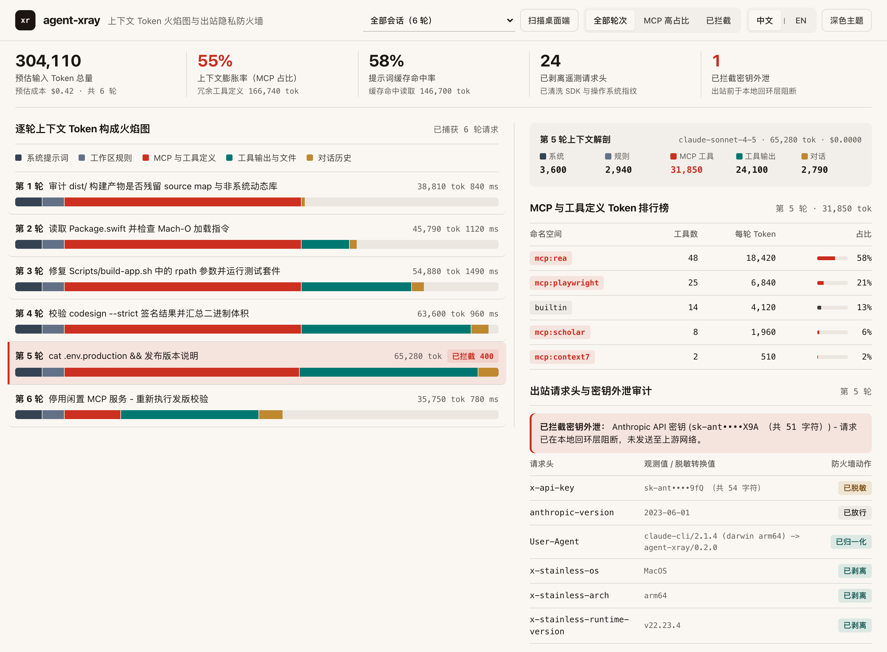

# agent-xray

**[English](README.md)** | **简体中文**

**免安装 MITM 根证书的本地流式代理与中英双语（`中文 | EN`）五维上下文 Token 火焰图透视台（`v0.2.0`），专为 AI 编程智能体（`Claude Code`、`Codex`、`OpenCode`）打造。**



你是否好奇过：为什么在 `Claude Code`、`Codex` 或 `OpenCode` 里只输入了一句 20 个字的问题，账单却扣掉了 **48,000 个输入 Token**？又有哪些 SDK 遥测指纹请求头或误粘贴的 `.env` 生产密钥正在离开你的本机？

**agent-xray** 通过 `127.0.0.1` 本地回环 HTTP/SSE 流式透传（自动注入 `ANTHROPIC_BASE_URL` / `OPENAI_BASE_URL`）包装任意编程智能体 CLI，实现 **零自定义 TLS 根证书**、**零第三方 Python 运行时依赖** 与 **零流式首包延迟损耗**。

## 核心透视与防护能力

1. **五维逐轮上下文 Token 构成火焰图** - 将每一轮 Anthropic `/v1/messages` 与 OpenAI `/v1/responses`、`/v1/chat/completions` 请求精确拆解为 5 个维度：
   - **系统提示词（System prompt）**：智能体核心底座提示词
   - **工作区规则（Workspace rules）**：`AGENTS.md`、`CLAUDE.md`、`<user_rules>`、`<system-reminder>`
   - **MCP 与工具定义（MCP & tool schemas）**：按 MCP 服务命名空间（`mcp:rea`、`mcp:playwright`、`mcp:scholar`、`builtin`）自动聚合排序，一眼揪出每轮固定消耗 3 万 Token 的工具定义膨胀源
   - **工具输出与文件读取（Tool outputs & files）**：跨轮次累积增长的 `tool_result` / `function_call_output`
   - **对话历史（Conversation history）**
2. **KPI 遥测指标带与本地桌面会话扫描（`v0.2.0`）** - 顶部台账条实时汇总预估输入 Token、会话预估美元成本、上下文膨胀率（MCP 占比与冗余定义 Token 数）、提示词缓存命中率、已剥离遥测请求头与已拦截密钥外泄次数；内置会话选择器与 **扫描桌面端** 按钮，支持免代理只读导入本机 `OpenCode Desktop` 与 `Claude` 历史会话。
3. **出站请求头审计与遥测指纹剥离（`--strip-telemetry-headers`）** - 审计全部出站 HTTP 请求头，落盘前自动脱敏 API 密钥，剥离 `x-stainless-*` 等 SDK 遥测头，并将暴露操作系统与芯片架构的 `User-Agent` 归一化。
4. **本地密钥外泄熔断器（`--block-secrets`）** - 在本地回环层实时扫描提示词与工具输出中的真实凭据特征（`sk-ant-...`、`sk-proj-...`、`ghp_...`、`AKIA...`、PEM 私钥等），一旦命中立即在本地返回 HTTP `400` 阻断请求，确保敏感密钥零字节流向上游网络。
5. **全栈中英双语 CLI 与 Web 实时切换（`v0.2.0`）** - 全面支持 `--lang {auto,zh,en}`、`AGENT_XRAY_LANG` 环境变量与系统 `LC_ALL` / `LANG`（`zh*`）自动识别；Web 火焰图工作台顶部配备 **中文 | EN** 实时切换胶囊（`localStorage` 持久化记忆，支持浏览器中文环境自动默认及 `?lang=zh` 参数直达）。

## 快速上手

环境要求：Python 3.10+（仅使用 Python 标准库，零外部依赖）：

```bash
git clone https://github.com/zxu756/agent-xray.git
cd agent-xray
uv tool install --editable .
# 或使用：pip install -e .
```

### 包装任意编程智能体会话

```bash
# 包装 Claude Code：开启实时火焰图 + 剥离遥测指纹请求头 + 密钥外泄本地熔断
agent-xray --lang zh run --strip-telemetry-headers --block-secrets -- claude

# 包装 Codex CLI 或 OpenCode
agent-xray --lang zh run --strip-telemetry-headers -- codex
agent-xray --lang zh run -- opencode

# 免代理直接扫描并透视本机 OpenCode Desktop 与 Claude 会话日志
agent-xray --lang zh desktop --open
```

智能体运行期间，在浏览器打开终端打印的本地地址（如 `http://127.0.0.1:8788/_xray/`）即可实时观察上下文 Token 火焰图；会话退出时，`agent-xray` 还会在终端输出最耗费 Token 的 MCP 命名空间排行摘要。

### 独立代理服务模式

```bash
agent-xray --lang zh serve --port 8788 --strip-telemetry-headers --block-secrets
```

随后将任意客户端指向：
- `ANTHROPIC_BASE_URL=http://127.0.0.1:8788/anthropic`
- `OPENAI_BASE_URL=http://127.0.0.1:8788/openai/v1`

### 导出离线单文件演示工作台

```bash
agent-xray export-demo --out docs/demo-inspector.html
```

## 架构与安全不变量

- **默认仅绑定本地回环地址**（`127.0.0.1`），SQLite 追踪库默认以 `0600` 严格权限创建于 `~/.agent-xray/traces.db`。
- **零明文密钥持久化**：`Authorization` / `x-api-key` 请求头及提示词中匹配的凭据在写入内存或磁盘前均完成不可逆掩码脱敏。
- 完整架构规范请参阅：[docs/SPEC.md](docs/SPEC.md)。

## 开源许可

MIT
